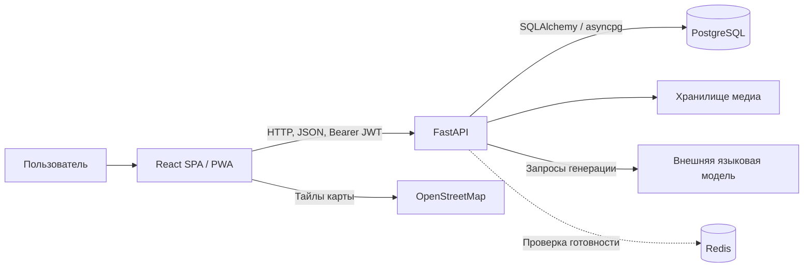
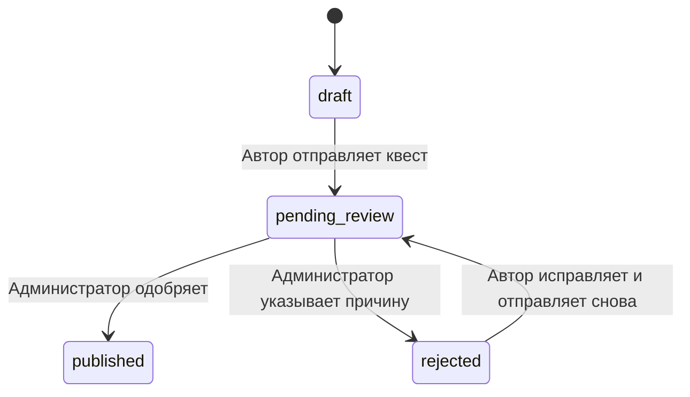

# QuestCity — описание реализованного проекта

Материал для подготовки пояснительной записки. Состояние проекта: 14 октября 2026 года. Описание составлено по исходному коду, конфигурации и результатам выполненных проверок. Это техническая основа записки; оформление титульного листа, ссылки на литературу и требования учебного заведения в неё не включены.

## 1. Назначение и результат разработки

QuestCity — веб-приложение для создания и прохождения городских пешеходных квестов. Пользователь знакомится с городом через последовательность остановок: получает ориентир, находит место, решает задание и открывает связанную с ним историю. Приложение объединяет конструктор маршрутов, каталог, игровое прохождение, административную проверку и помощь языковой модели при подготовке материалов.

Цель разработки можно сформулировать как создание программной системы, которая позволяет авторам составлять интерактивные городские маршруты, а игрокам — проходить их с использованием карты, геолокации, заданий и сохраняемого прогресса.

В текущей версии реализован полный основной сценарий: регистрация → создание черновика → добавление контрольных точек → проверка администратором → публикация в каталоге → прохождение → итоговые баллы и условная награда.

Проект представляет собой работающий прототип с клиентской и серверной частями, постоянным хранением данных и демонстрационными маршрутами. Публичное промышленное развёртывание в состав завершённых работ не входит.

## 2. Пользователи и разграничение доступа

В модели пользователя предусмотрены роли `player`, `author` и `admin`.

| Участник | Реализованные возможности |
|---|---|
| Гость | Просмотр главной страницы, переход к регистрации и входу |
| Игрок | Просмотр каталога после входа, выбор маршрута, запуск и продолжение прохождения, ответы, подсказки, дневник и результат |
| Автор | Возможности игрока, создание собственных квестов, работа с черновиками, генерация сценария, добавление точек, настройка проводника, отправка на проверку |
| Администратор | Проверка квестов, просмотр правильных ответов и материалов, одобрение или отклонение, настройка наград и мест для остановки |

Регистрация создаёт пользователя с ролью игрока. При создании первого квеста вручную или через генератор сервер переводит игрока в роль автора. Отдельная заявка на авторство не реализована. Проверка права изменить квест основывается на его принадлежности текущему пользователю, а административные операции отдельно требуют роль `admin`.

Главная страница открыта гостям. Остальные предметные страницы клиентского приложения защищены `ProtectedRoute`: без авторизации выполняется переход на страницу входа. При этом серверный метод получения списка опубликованных квестов сам по себе не требует токена. Клиентская навигация и серверные права — разные уровни контроля.

## 3. Технологии

| Компонент | Технологии | Использование в проекте |
|---|---|---|
| Клиент | React 19, TypeScript | Компоненты интерфейса, типы API и клиентская логика |
| Сборка клиента | Vite 7 | Сервер разработки и подготовка статических файлов |
| Интерфейс | Material UI 7, Emotion | Формы, карточки, диалоги, навигация и общая тема |
| Навигация | React Router 7 | Маршрутизация между страницами без полной перезагрузки |
| Серверные данные клиента | TanStack React Query 5 | Загрузка, кеш запросов, мутации и обновление интерфейса |
| Карта | Leaflet, OpenStreetMap | Карта текущей точки и мест для остановки |
| PWA | vite-plugin-pwa, Workbox | Манифест, service worker и кеширование ресурсов |
| Сервер | Python, FastAPI, Uvicorn | HTTP API и выполнение прикладной логики; Docker-образ использует Python 3.12 |
| Проверка данных | Pydantic 2, pydantic-settings | Схемы запросов, ответов и конфигурации |
| Доступ к БД | SQLAlchemy 2, asyncpg | Асинхронные запросы и ORM |
| База данных | PostgreSQL 16 в образе PostGIS 3.4 | Постоянное хранение пользователей, квестов и прохождений |
| Миграции | Alembic | Последовательное изменение схемы БД |
| Дополнительный сервис | Redis 7.4 | Подключён в инфраструктуре и проверяется методом readiness |
| Авторизация | PyJWT, pwdlib с Argon2 | JWT-токены и хеширование паролей |
| Внешняя генерация | httpx, API формата Chat Completions | Серверное обращение к языковой модели |
| Развёртывание | Docker, Docker Compose; Nginx для production-образа клиента | Сборка и запуск компонентов |
| Проверки | pytest, pytest-asyncio, Ruff, ESLint, TypeScript | Проверка серверной логики, типов и качества кода |

PostGIS доступен в образе БД, но координаты точек хранятся как обычные числовые поля. Пространственные запросы PostGIS и пространственные индексы в прикладной логике не используются. Расстояния рассчитываются в Python и в клиентском коде.

Redis пока не хранит игровой прогресс, не обслуживает очередь генерации и не используется как общий кеш. Его фактическое использование в коде — проверка доступности при оценке готовности сервера.

## 4. Архитектура

Приложение построено по клиент-серверной архитектуре. Клиент — SPA: браузер загружает приложение и переключает страницы средствами React Router. Сервер — единое приложение FastAPI с модулями по предметным областям. Разделения на микросервисы нет.



Проверка ответов, начисление баллов, продвижение по маршруту и выдача награды выполняются сервером. Клиент показывает полученное состояние и отправляет действия пользователя. Это позволяет сохранять прогресс независимо от перезагрузки страницы и не доверять присланному клиентом значению баллов.

Серверные исходники разделены на:

- `api/routes` — обработчики HTTP-запросов;
- `api/deps.py` — получение текущего пользователя и сессии БД;
- `models` — ORM-модели;
- `schemas` — структуры и правила проверки данных;
- `core` — настройки, подключение к БД и работа с токенами;
- `game` — функции проверки ответов и расстояний;
- `generation` — формирование запросов к модели и проверка её ответа.

Клиент разделён на `pages`, переиспользуемые `components`, функциональные блоки `features`, модуль `auth`, API-клиент и настройки приложения `app`. Страницы загружаются лениво через `React.lazy` и `Suspense`, что разделяет клиентскую сборку на части.

## 5. Страницы и интерфейс

| Адрес | Назначение |
|---|---|
| `/` | Главная страница с представлением проекта и навигацией по разделам |
| `/register` | Регистрация |
| `/login` | Вход |
| `/quests` | Каталог и вкладка «Мои квесты» |
| `/quests/new` | Создание квеста вручную и переход к генератору |
| `/quests/new/generate` | Анкета и проверка параметров генерации |
| `/quests/:questId` | Представление выбранного квеста и начало прохождения |
| `/quests/:questId/edit` | Конструктор авторского квеста |
| `/play/:sessionId` | Игровое прохождение и финальный результат |
| `/admin` | Проверка квестов, награды и места для остановки |
| `/demo` | Переход к демонстрационному маршруту |

Все основные страницы приведены к общей визуальной системе. Она задаётся темой Material UI: единые цвета, типографика, отступы, скругления, поля ввода и кнопки. Основной акцентный цвет — фиолетовый. Общие компоненты отвечают за шапку, заголовки, состояния загрузки, пустые результаты и сообщения об ошибках.

Реализована адаптивная раскладка с контрольными ширинами 640, 1024 и 1280 px. На узких экранах колонки становятся вертикальными, длинные подписи полей переносятся, навигация сворачивается в меню, диалоги ограничиваются высотой экрана. Поля на мобильных экранах используют размер текста 16 px. Для кнопок со значками предусмотрена область нажатия не менее 44×44 px.

В интерфейсе используются семантические заголовки, подписи полей, названия действий для средств доступности, видимый фокус клавиатуры и учёт `prefers-reduced-motion`. Полная сертификация доступности не проводилась.

## 6. Регистрация и авторизация

При регистрации пользователь вводит имя, email и пароль. Сервер проверяет формат email, длину имени и пароля, нормализует имя и приводит email к нижнему регистру. Пароль должен содержать от 8 до 128 символов. Повторная регистрация с существующим email отклоняется.

Пароль хранится в виде хеша, сформированного `pwdlib` с Argon2. При входе сервер проверяет пароль и активность пользователя. В модель включён флаг `is_active`, однако отдельный пользовательский интерфейс управления блокировками не реализован.

После входа сервер выдаёт:

- access JWT для обращения к защищённому API;
- refresh JWT в cookie с `HttpOnly` и `SameSite=Lax`.

Access-токен хранится в памяти React-контекста и передаётся в заголовке `Authorization: Bearer ...`. После загрузки приложения клиент вызывает `/auth/refresh` и восстанавливает вход по cookie. В настройках по умолчанию срок access-токена составляет 15 минут, refresh-токена — 30 дней; подпись JWT выполняется алгоритмом HS256.

Признак `Secure` у cookie настраивается через окружение и в локальной конфигурации выключен. Выход удаляет refresh-cookie и очищает состояние клиента. Серверный список отозванных токенов не реализован. Также API-клиент пока не выполняет автоматическое обновление access-токена и повтор запроса после каждого ответа 401: восстановление реализовано при запуске приложения.

## 7. Каталог и собственные квесты

Каталог содержит опубликованные квесты. В карточке показываются название, город, краткое описание, ориентировочная длительность и количество точек. Предусмотрены поиск по названию или городу и фильтр по городам. Поиск и фильтрация выполняются на клиенте по загруженному списку; серверная пагинация и полнотекстовый поиск не реализованы.

Вкладка «Мои квесты» показывает маршруты текущего автора с их статусами. Черновики можно открыть в конструкторе. Страница опубликованного квеста показывает общую информацию, проводника, первую точку на карте, места для остановки и действие начала игры.

Для обычного просмотра сервер не возвращает правильные ответы и содержание будущих заданий. Из контрольных точек в кратком представлении доступны идентификаторы и позиции; отдельно передаются координаты старта. Полная авторская структура используется только для владельца и административной проверки.

## 8. Конструктор квеста

При ручном создании задаются название, описание, город и длительность. Сервер сохраняет квест как черновик и связывает его с автором.

В конструкторе маршрут формируется последовательным добавлением контрольных точек. Для каждой точки задаются:

| Группа | Данные |
|---|---|
| Место | Название, описание, широта, долгота, радиус активации |
| Задание | Тип, вопрос, варианты или правильная последовательность, правильный ответ, фотография при необходимости |
| Помощь | До трёх подсказок с отдельной стоимостью |
| Переход | Ориентир для поиска места и короткие факты по дороге |
| Материал после задания | Заголовок, текст, изображение, аудио, подпись и ссылка на источник |

Позиция новой точки назначается сервером по текущему числу точек. Маршрут линейный: игрок проходит точки в порядке их добавления. В авторской форме сейчас используются 100 баллов и 3 попытки на точку. Серверная схема позволяет задать другие значения: от 0 до 10 000 баллов и от 1 до 20 попыток.

Радиус активации ограничен диапазоном 10–500 м, по умолчанию — 50 м. Проверяются диапазоны координат, длина текста, варианты ответа и суммарная стоимость подсказок.

Работа с точками в текущем интерфейсе ориентирована на добавление. Удаление, перестановка и полноценное редактирование уже сохранённых точек отдельными операциями не реализованы. Сервер поддерживает обновление основных полей квеста, но конструктор не является полноценным универсальным редактором всех данных маршрута.

## 9. Типы заданий

### 9.1. Текстовый ответ

Игрок вводит строку. Сервер сравнивает её с эталоном после нормализации: удаляет лишние пробелы, игнорирует регистр и заменяет `ё` на `е`. Поэтому ответы, различающиеся только регистром, пробелами или использованием `е`/`ё`, считаются одинаковыми.

Проверка детерминированная. Семантическая оценка ответа языковой моделью, исправление произвольных опечаток и поиск синонимов не реализованы.

### 9.2. Один вариант ответа

Игрок выбирает один из предложенных вариантов. Автор должен задать не менее двух разных вариантов, а правильный ответ обязан присутствовать в списке. Максимум — десять вариантов. Проверка ответа выполняется сервером.

### 9.3. Фотозагадка

Автор загружает изображение и составляет вопрос. Игрок отвечает текстом либо выбирает вариант. Изображение задания появляется после открытия текущей точки.

Это задание по изображению автора. Съёмка фотографии игроком, распознавание объектов, автоматическое сравнение фотографий и проверка ответа компьютерным зрением не реализованы.

### 9.4. Восстановление последовательности

Автор вводит элементы в правильном порядке. В БД сохраняются список элементов и эталонная последовательность. Сервер перемешивает элементы для игрока; порядок зависит от идентификаторов игровой сессии и точки и остаётся стабильным при повторной загрузке. Если результат перемешивания совпал с эталоном, список дополнительно сдвигается.

Игрок переставляет элементы кнопками вверх и вниз. Такой способ работает на телефоне и не требует перетаскивания. Сервер сначала проверяет, что ответ содержит каждый элемент ровно один раз, затем сравнивает порядок с эталоном. Правильная последовательность заранее игроку не передаётся.

## 10. Статусы и модерация

В модели квеста предусмотрены `draft`, `pending_review`, `published`, `rejected` и `archived`. Реализован рабочий цикл:



Автор может изменять квест в состояниях черновика или отклонения. Перед отправкой сервер требует хотя бы одну точку. Для сгенерированных квестов дополнительно требуется подтверждение всех предложенных точек.

Администратор видит очередь проверки, полные задания, ответы, фотографии и подсказки. Он может одобрить квест или вернуть его автору с причиной. После одобрения маршрут появляется в каталоге. Статус архива предусмотрен моделью, но отдельный сценарий архивирования в интерфейсе и API не реализован.

## 11. Игровое прохождение

При начале игры сервер проверяет, что квест опубликован и содержит точки. Если у этого игрока уже есть активная сессия выбранного квеста, сервер возвращает её. Повторное нажатие «Начать» позволяет продолжить незавершённый маршрут. После завершения можно создать новую сессию.

Основная последовательность действий:

1. Игрок получает ориентир и карту текущей точки.
2. По дороге может последовательно открывать короткие факты.
3. Подтверждает прибытие геолокацией или кнопкой демонстрационного режима.
4. Получает вопрос, фотографию или элементы последовательности.
5. При необходимости открывает подсказки.
6. Отправляет ответ.
7. После правильного ответа либо исчерпания попыток получает материал главы и переходит к следующей точке.
8. После последней точки видит завершение, итоговые баллы, дневник и доступную награду.

При неправильном ответе и оставшихся попытках игрок остаётся на текущем задании. Если попытки закончились, система показывает правильный ответ, открывает материал главы и продолжает маршрут без начисления баллов за эту точку. Ошибка не блокирует завершение всей прогулки.

На сервере сохраняются текущая точка, её открытое состояние, общий счёт, открытые факты, подсказки, попытки и время прохождения. Перезагрузка восстанавливает эти данные. Неотправленный текст ответа и локальные перестановки элементов отдельным черновиком на сервере не сохраняются.

В модели предусмотрены статусы сессии `active`, `completed`, `abandoned`. Рабочий сценарий использует первые два; отдельная операция отказа от прохождения не реализована.

## 12. Геолокация и карта

Клиент использует `navigator.geolocation.getCurrentPosition` с запросом повышенной точности и тайм-аутом 15 секунд. Широта, долгота и оценка точности отправляются серверу.

Сервер вычисляет расстояние до контрольной точки по формуле гаверсинусов, используя радиус Земли 6 371 000 м. При заявленной точности хуже 100 м запрос отклоняется. Допустимое расстояние рассчитывается так:

```text
допустимое расстояние = радиус активации точки + min(погрешность геолокации, 30 м)
```

Если игрок находится в этом диапазоне, точка открывается. Полноценная защита от подмены координат не реализована: сервер проверяет переданные браузером значения.

Настройка `ALLOW_LOCATION_BYPASS` позволяет открыть точку без геолокации. В локальной версии она включена для демонстраций. Этот режим определяется настройкой всего сервера, а не отдельным признаком конкретного квеста.

Интерактивная карта построена на Leaflet. Подложка загружается из OpenStreetMap; есть масштабирование, отметка текущей точки, маркеры остановок, всплывающие карточки и переход к выбранному месту. Карта подстраивается под изменение размера контейнера. Ошибки загрузки подложки показываются пользователю.

На странице представления показывается старт, а в игре — текущая точка. Будущие игровые координаты не передаются заранее в обычном представлении. Построение пешеходной линии маршрута, голосовая навигация, оптимизация порядка остановок и расчёт времени пешего перехода не реализованы.

## 13. Подсказки и баллы

У точки может быть до трёх подсказок. Для каждой сохраняются текст и стоимость. Сумма стоимостей не может превышать баллы точки. В текущей форме автор задаёт стоимость в диапазоне 0–100, соответствующем фиксированным 100 баллам точки.

Игрок открывает подсказки по порядку. Перед открытием диалог сообщает, на сколько уменьшится возможная награда. Уже заработанные на предыдущих точках баллы не списываются.

```text
баллы за правильный ответ = max(0, баллы точки − сумма стоимостей открытых подсказок)
баллы за неправильный ответ = 0
```

Например, точка оценивается в 100 баллов, а открытая подсказка стоит 20. Правильный ответ принесёт 80 баллов. Повторный запрос уже открытой подсказки не увеличивает стоимость; открытые подсказки доступны после перезагрузки.

Количество открытых подсказок хранится в JSON-поле сессии, где ключом является идентификатор точки. Тексты ещё не открытых подсказок не передаются игроку заранее.

Максимальный результат маршрута — сумма исходных баллов его точек. Восстановление попыток и штрафов выполняется из серверного состояния.

## 14. Материалы глав и дневник

После завершения задания игрок получает карточку с дополнительной историей. Она может содержать текст, изображение, аудио, подпись и ссылку на источник. Это отделяет вопрос от познавательного материала.

Дневник содержит только пройденные главы, включая главы, где попытки были исчерпаны. Сервер формирует дневник по текущему индексу прохождения и материалам контрольных точек. Он не хранится отдельной таблицей. Дневник доступен во время игры, после перезагрузки и на финальном экране.

Будущие материалы не включаются в игровой ответ до завершения соответствующей главы. Это ограничение действует на уровне выдачи данных API; сами загруженные файлы раздаются статическим маршрутом `/media` без отдельных прав на каждый файл.

## 15. Персонаж-проводник

Для квеста можно включить капитана, хранителя историй или исследователя. Автор выбирает образ, задаёт имя, приветствие и финальную реплику. Настройки сохраняются в JSON-поле квеста.

Проводник показан на странице маршрута и во время прохождения. Для начала и финала используются сохранённые реплики, для промежуточных состояний — подготовленные интерфейсом сообщения с учётом состояния точки.

Проводник — элемент повествования. Отдельный чат, голосовой диалог, генерация ответов персонажа во время игры и автономное поведение не реализованы. Языковая модель может помочь автору заранее подготовить реплики.

## 16. Генератор квестов

Автор заполняет анкету: город, район, тему, идею, аудиторию, длительность, число точек, сложность, настроение, формат заданий, образ проводника, обязательные и исключённые места, ограничения и исходные материалы.

Анкета сохраняется в `localStorage` отдельно для пользователя в текущем браузере. Это локальное сохранение формы, которое не переносится автоматически на другое устройство.

Сервер обращается к внешней языковой модели через API формата Chat Completions. Используются `httpx`, серверный ключ и настройки провайдера из окружения. В конфигурации по умолчанию задан Starimg и идентификатор модели `gpt-6-luna`; эти значения можно менять. Собственная модель в проекте не обучается.

Порядок обработки:

1. Pydantic проверяет анкету и ограничения.
2. Сервер формирует системные правила и отдельное сообщение с данными автора.
3. Выполняется один запрос к провайдеру с ожиданием JSON-ответа.
4. Сервер проверяет завершённость ответа, его размер, JSON и структуру `GeneratedQuest`.
5. Дополнительно проверяются город, число точек и заданный формат ответов.
6. Корректный план сохраняется в `generation_plan` нового авторского черновика.
7. Автор открывает предложенную точку, проверяет факты, вручную вводит координаты и добавляет её в маршрут.
8. После подтверждения всех предложений квест можно отправить на модерацию.

План содержит места, вопросы, варианты, ответы, последовательности, подсказки, ориентиры, факты, материалы глав и замечания для проверки. Полная генерация поддерживает текстовые задания, выбор варианта и последовательности. Фотозагадки автор добавляет вручную с изображением.

Координаты в генерируемой структуре отсутствуют. Языковая модель не заменяет проверку маршрута на местности. Системные инструкции требуют не придумывать факты и источники, но это не является автоматической гарантией исторической достоверности: фактическая проверка остаётся задачей автора.

Подтверждённые индексы предложений сохраняются вместе с добавлением точки в одной транзакции. Повторное добавление того же предложения отклоняется. При тайм-ауте, ошибке провайдера или некорректном ответе черновик не создаётся. Автоматические повторные платные запросы отсутствуют.

Одновременные запросы одного пользователя ограничены набором идентификаторов в памяти серверного процесса. Общая очередь заданий, фоновый worker и распределённое ограничение для нескольких процессов не реализованы. Признак доступности генератора означает наличие настроенного ключа, а не успешную проверку провайдера в момент чтения статуса.

## 17. ИИ-помощь для отдельных полей

Кнопки ✨ в авторских формах запрашивают предложение для конкретного поля. Пользователь видит результат в диалоге, может добавить пожелание, получить другой вариант или явно применить предложение. Закрытие диалога оставляет форму без изменений. Применение не сохраняет и не публикует квест автоматически.

Запрос включает название поля, область формы, текущий контекст и инструкцию автора. Сервер проверяет перечень разрешённых полей и ключей контекста, общий размер и тип результата. Для чисел, перечислений, логических значений, текста, вариантов ответа и фактов действуют отдельные ограничения.

Предложения поддерживают названия, описания, вопросы, варианты, факты, параметры анкеты, подсказки и реплики проводника. Для координат сервер возвращает пояснение о необходимости выбрать реальную точку по карте без обращения к модели. Для ссылки на источник используются предоставленные автором данные. Загрузка фотографии остаётся ручной операцией.

## 18. Места для остановки и партнёрские предложения

К маршруту можно добавить кофейни, места питания и отдыха. Администратор задаёт название, категорию, адрес, описание, ссылку, координаты при наличии и активность. На один квест допускается до 30 записей. Хранение выполнено в JSON-поле `quests.partner_places`, отдельной таблицы заведений нет.

Запись имеет статус `candidate` либо `partner`. Для обычного места не разрешено задавать партнёрское предложение. Подтверждённому партнёру можно добавить предложение, а неактивные места исключаются из ответов игроку. Автор квеста не может самостоятельно назначить месту партнёрский статус.

В клиенте есть фильтры «Кофе», «Поесть», «Отдохнуть», карточки и связь с маркерами карты. Записи без координат остаются адресными карточками. Отображаемое расстояние является оценкой по прямой от текущей точки квеста, а не от живого положения пользователя и не расстоянием пешего маршрута.

Выбор остановки не меняет игровую точку и не сбрасывает прогресс. Автоматический поиск заведений, бронирование, заказы и проверка актуальных часов работы не реализованы.

## 19. Награды

Администратор может настроить для квеста одну награду: партнёра, адрес, предложение, промокод, инструкцию получения, порог баллов, активность и признак демонстрационного кода.

Сервер возвращает награду, если сессия завершена, награда активна и итоговый счёт не ниже установленного порога. До выполнения условий промокод не передаётся через игровой ответ. Учебные коды помечаются в интерфейсе как недействующие в реальном заведении.

Промокод сейчас общий для квеста. Выпуск уникального кода для каждого игрока, учёт его погашения и интеграция с кассой партнёра не реализованы.

## 20. Хранение данных

Основные данные хранятся в PostgreSQL. Объекты имеют UUID-идентификаторы; большинство основных сущностей также хранит даты создания и изменения. Связи задаются внешними ключами.

| Таблица | Основные сведения |
|---|---|
| `users` | Email, отображаемое имя, хеш пароля, роль, активность |
| `quests` | Автор, название, город, описание, статус, длительность, причина отклонения, план генерации, проводник, места для остановки |
| `checkpoints` | Квест и позиция, координаты, радиус, задание, ответы, баллы, попытки, подсказки, фото и материалы главы |
| `quest_rewards` | Одна награда квеста, предложение, код, условия и порог баллов |
| `game_sessions` | Игрок, квест, состояние прохождения, текущая точка, баллы, открытые факты и подсказки, время старта и завершения |
| `task_attempts` | Сессия, точка, отправленный ответ, правильность, начисленные баллы и время попытки |

Основные связи: пользователь создаёт много квестов; квест содержит много точек и не более одной награды; игрок имеет много сессий; сессия содержит много попыток. Квест может проходиться разными игроками и повторно после завершения.

Ответ последовательности сохраняется в текстовом поле попытки как JSON-строка. Переменные структуры — списки вариантов, фактов и подсказок, проводник и план генерации — хранятся в JSON-полях. Отдельных таблиц для каждой такой структуры нет.

Изменение схемы выполнено семью миграциями Alembic: пользователи; квесты и прохождения; материалы глав; история, награды и модерация; план генерации; места для остановки; новые задания, подсказки и проводник.

## 21. API и обработка ошибок

API использует префикс `/api/v1`. FastAPI формирует OpenAPI и интерактивную документацию `/docs`.

| Группа | Основные операции |
|---|---|
| `/auth` | Регистрация, вход, обновление сессии, выход, текущий пользователь |
| `/quests` | Каталог, свои квесты, создание, чтение, авторское представление, изменение, добавление точки, отправка на проверку |
| `/quest-generation` | Доступность модели, проверка анкеты, генерация плана, предложение поля |
| `/game-sessions` | Начало/продолжение, чтение, прибытие, ответ, подсказка, следующий факт, открытие без GPS |
| `/admin` | Очередь проверки, полный квест, одобрение, отклонение, чтение и сохранение наград и остановок |
| `/media` | Загрузка изображения или аудио |
| `/health` | Проверка работы процесса и доступности зависимостей |

Используются HTTP-коды 401 для отсутствия авторизации, 403 для недостаточных прав, 404 для недоступных объектов, 409 для конфликтов состояния, 422 для некорректных данных и отдельные коды для ошибок внешнего провайдера.

API-клиент преобразует ошибки в `ApiError`, извлекает сообщения валидации и показывает их в интерфейсе. Формы используют состояния ожидания и блокируют повторные действия во время запроса.

## 22. Согласованность игрового состояния

При ответах, открытии точки, подсказках и фактах сервер загружает сессию с блокировкой строки `SELECT ... FOR UPDATE`. Операции одной сессии выполняются последовательно, что предотвращает одновременное начисление баллов за один этап и конфликтующие изменения состояния.

Запись попытки, изменение счёта и переход к следующей точке сохраняются одной транзакцией. При запуске игры блокируется квест и проверяется существующая активная сессия. При добавлении точки блокируется запись квеста, чтобы согласовать назначение позиции и подтверждение предложения генератора.

Сервер проверяет принадлежность сессии игроку, состояние прохождения и доступность текущего задания. Нельзя получить чужую сессию обычным игровым запросом, ответить до открытия точки или запросить подсказку будущего задания.

## 23. Медиа и PWA

Загрузка медиа требует авторизации. Поддерживаются JPG, PNG, WebP, GIF, MP3, M4A, OGG, WAV и WebM. Сервер проверяет заявленный MIME-тип и ограничивает размер; по умолчанию предел — 20 МБ. Имя сохранённого файла генерируется из UUID, чтобы не использовать исходное имя как путь.

Файлы хранятся в каталоге сервера, который в Compose подключён к постоянному тому. FastAPI раздаёт их через `/media`. Облачное хранилище, антивирусная проверка, полноценная проверка содержимого файла и управление сроком хранения пока отсутствуют.

Для PWA настроены название, иконка, цвета, стартовая страница и режим `standalone`. Service worker регистрируется при запуске клиента и настраивается на автоматическое обновление. В production-сборке кешируются ресурсы приложения; для изображений предусмотрен кеш до 80 записей с максимальным возрастом семь дней. Тайлы стандартного OpenStreetMap исключены из этого runtime-кеша изображений.

Установка приложения зависит от поддержки и условий браузера. PWA не означает, что весь квест можно пройти без интернета: API, отправка ответов, генерация и загрузка карты требуют связи. Очередь действий офлайн и последующая синхронизация не реализованы.

## 24. Запуск и конфигурация

Docker Compose запускает четыре сервиса: frontend, backend, PostgreSQL и Redis. Клиент доступен на порту 5173, API — на 8000. При старте backend применяет миграции Alembic и запускает Uvicorn. Используются проверки готовности сервисов и постоянные тома БД, Redis и медиа.

Конфигурация задаётся переменными окружения: подключения к БД и Redis, JWT, CORS, cookie, демонстрационный режим и параметры LLM. Ключ модели используется сервером и не включается в клиентские переменные `VITE_*`.

Для клиента подготовлен также production-образ Nginx. Он обслуживает статическую сборку и возвращает `index.html` для внутренних маршрутов SPA. Основной Compose настроен на разработку: Vite, bind-mount исходников и автоматическая перезагрузка backend. Полная production-конфигурация с HTTPS, доменом, резервным копированием и эксплуатационным мониторингом не входит в текущую реализацию.

## 25. Проверки и демонстрация

В серверном проекте реализованы автоматические тесты для нормализации ответов, расстояний, паролей и токенов, схем данных, защиты ответов, генерации, ошибок провайдера, полевых предложений, остановок, дневника, возобновления игры, подсказок и последовательностей.

Последний выполненный прогон: 87 тестов прошли, Ruff, TypeScript/Vite и ESLint завершились успешно. Часть тестов использует подменённые БД и HTTP-транспорт; это проверки логики и контрактов, а не полный автоматизированный набор испытаний с PostgreSQL и реальным провайдером.

Дополнительно выполнялись прохождение через API с PostgreSQL и проверки интерфейса в Chromium. Адаптивность основных страниц проверена на 24 ширинах 320–2560 px, новые формы — дополнительными 27 замерами, включая горизонтальную ориентацию. В ходе проверки исправлены переполнения, подписи полей, размеры действий и диалоги. Safari, Firefox и физические устройства не охвачены этой браузерной проверкой.

Для демонстрации подготовлены маршруты Таганрога. Первый знакомит с городскими историями через четыре точки, факты, материалы и учебную награду. Второй — «Таганрог: испытания капитана» — показывает фотозагадку, последовательность и текстовое задание, проводника и подсказки. Seed-скрипты проверяют наличие демонстрационных данных и не должны создавать повторный маршрут при повторном запуске.

## 26. Границы текущей версии

Для пояснительной записки следующие возможности следует описывать как ограничения или дальнейшее развитие:

- полноценное изменение, удаление и перестановка сохранённых точек;
- отдельный сценарий архивирования квеста и прекращения игровой сессии;
- история всех прохождений в личном кабинете, рейтинги, отзывы и достижения;
- групповая игра, командные результаты и социальные функции;
- пешеходная навигация и автоматическая оптимизация маршрута;
- фотографирование игроком и распознавание объектов;
- автоматическая проверка исторических фактов и источников;
- диалог с проводником во время игры;
- общий каталог заведений и подтверждённые коммерческие интеграции;
- индивидуальные промокоды и регистрация их погашения;
- полноценная игра офлайн;
- распределённая очередь генерации и общие ограничения запросов;
- восстановление пароля, подтверждение email и серверное аннулирование токенов;
- промышленное развёртывание, резервное копирование и нагрузочные испытания.

Эти пункты не означают отсутствие основных сценариев: создание, модерация и прохождение работают. Они определяют пределы реализованного прототипа.

## 27. Возможная структура пояснительной записки

1. Введение: предметная область, проблема, цель и задачи разработки.
2. Анализ требований: пользователи, сценарии и функциональные требования.
3. Проектирование: клиент-серверная архитектура, модули и модель данных.
4. Реализация: авторизация, конструктор, модерация, игра, геолокация, подсказки и генератор.
5. Пользовательский интерфейс: страницы, адаптивность и состояния взаимодействия.
6. Тестирование: проверяемые сценарии, автоматические тесты и браузерная проверка.
7. Развёртывание: Docker Compose, миграции, конфигурация и демонстрационные данные.
8. Заключение: достигнутый результат, ограничения и направления развития.

Пример формулировки результата:

> В ходе разработки реализовано веб-приложение QuestCity для создания и прохождения городских квестов. Система включает регистрацию и авторизацию, каталог маршрутов, конструктор контрольных точек, административную модерацию, прохождение с геолокацией и сохранением прогресса, четыре типа заданий, подсказки с уменьшением награды, мультимедийные материалы и дневник. Дополнительно реализованы подготовка черновика сценария с помощью внешней языковой модели, предложения для отдельных авторских полей, персонаж-проводник и отображение мест для остановки. Основная игровая логика выполняется сервером, а данные сохраняются в PostgreSQL. Клиентский интерфейс адаптирован к мобильным экранам и содержит настройки PWA.

## 28. Где искать реализацию в исходном коде

| Область | Основные файлы относительно корня проекта |
|---|---|
| Подключение API | `backend/app/main.py` |
| Авторизация | `backend/app/api/routes/auth.py`, `backend/app/api/deps.py`, `backend/app/core/security.py` |
| Квесты и модерация | `backend/app/api/routes/quests.py`, `backend/app/api/routes/admin.py` |
| Игра | `backend/app/api/routes/game.py`, `backend/app/game/rules.py` |
| Модель данных | `backend/app/models/user.py`, `quest.py`, `game.py` |
| Валидация | `backend/app/schemas/quest.py`, `generation.py`, `game.py`, `partners.py` |
| Генерация | `backend/app/generation/provider.py`, `prompt.py`, `fields.py` |
| Медиа | `backend/app/api/routes/media.py` |
| Маршруты клиента | `frontend/src/app/App.tsx` |
| Тема и адаптивность | `frontend/src/app/theme.ts`, `global.css` |
| Клиентская авторизация | `frontend/src/auth/AuthContext.tsx`, `ProtectedRoute.tsx` |
| API-клиент | `frontend/src/api/client.ts` |
| Страницы | `frontend/src/pages/` |
| Карта | `frontend/src/features/map/AdventureMap.tsx` |
| Остановки | `frontend/src/features/partners/` |
| Проводник | `frontend/src/features/adventure/` |
| Диалог ИИ | `frontend/src/components/AiField.tsx` |
| PWA и сборка | `frontend/vite.config.ts`, `frontend/src/main.tsx` |
| Миграции и тесты | `backend/alembic/versions/`, `backend/tests/` |
| Развёртывание | `compose.yaml`, `frontend/Dockerfile`, `backend/Dockerfile` |
| Адаптивная проверка | `docs/responsive-audit.md` |
